# AcousticNet: a computer network that talks through sound

> Laptops with **Wi-Fi, Bluetooth and cables all switched off** send each other files through the air, as sound.
> Every layer that makes this work was written from scratch in Python: the modem (five speeds, chosen automatically), framing, error detection and correction, retransmission, medium access, **multi-hop routing** through a relay laptop, and **encryption** that defeats an eavesdropping laptop.
> Every claim is backed by numbers you can reproduce: the simulations included here, plus hardware measurements you collect with one command each.

Computer Networks (BCSE308L) lab project, VIT Vellore.

---

## Contents

1. [The project in one minute](#1-the-project-in-one-minute)
2. [Why we built it (the novelty)](#2-why-we-built-it-the-novelty)
3. [How it works, layer by layer](#3-how-it-works-layer-by-layer)
4. [What we did: the build story and the bugs we fixed](#4-what-we-did-the-build-story-and-the-bugs-we-fixed)
5. [Results](#5-results)
6. [Every file in the folder and why it exists](#6-every-file-in-the-folder-and-why-it-exists)
7. [Setup (Windows, macOS, Linux)](#7-setup)
8. [How to demonstrate the project](#8-how-to-demonstrate-the-project)
9. [How to produce your own measured results](#9-how-to-produce-your-own-measured-results)
10. [Syllabus mapping](#10-syllabus-mapping)
11. [Viva questions and answers](#11-viva-questions-and-answers)
12. [Limitations and future work](#12-limitations-and-future-work)
13. [Command cheat-sheet](#13-command-cheat-sheet)

---

## 1. The project in one minute

**Analogy.** Wi-Fi is just radio waves carrying 1s and 0s. We replaced the radio with the laptop's **speaker and microphone**:

* a **1400 Hz** beep means **0**
* a **2600 Hz** beep means **1**
* 100 of these beeps per second = **100 bit/s** (the base speed)
* when the room is quiet, the link switches to **4 or 16 different tones**, up to **800 bit/s**

Sound is a terrible medium. It echoes, people talk, fans hum, two laptops "talking" at once garble each other, and *everyone in the room can hear everything*. That is exactly why it's a good teaching medium: every problem the syllabus describes (noise, errors, lost frames, collisions, delay, routing, eavesdropping) happens right in front of you, audibly, and our protocols have to solve it.

**What you will see in the demo**

| Moment | What happens | Network concept |
|---|---|---|
| Airplane mode on, `ping google.com` fails | there is no radio link at all | the medium is sound only |
| File transfer starts | modem screech; the dashboard shows every symbol as a tone | physical layer, framing |
| Someone claps near the receiver | that frame turns red: **CRC FAILED** | error detection |
| A moment later | only that one chunk is sent again | Selective Repeat ARQ |
| End | "SHA-256 matches: all 202 bytes arrived exactly as sent" | end-to-end reliability |
| A phone plays noise next to the receiver | the **speed** drops from 800 to 57 bit/s, and climbs back when it stops | **adaptive modulation** (like Wi-Fi) |
| A third laptop, "Eve", listens in | Eve **steals** an unencrypted file; on an encrypted one she sees random bytes; her replayed recording and her forged file are **refused** | **security**: confidentiality, integrity, freshness |
| Two laptops that can't hear each other | a relay laptop learns routes, `traceroute` shows `1 → 3 → 2`, the file arrives through the relay | **network layer**: distance-vector routing, TTL |
| Graphs | ALOHA / Slotted ALOHA / CSMA on a shared medium; speed ladder; count-to-infinity | measured against theory |

**The headline results**

1. **Reliable file transfer over sound** with Stop-and-Wait, Go-Back-N and Selective Repeat, verified bit-exact with SHA-256.
2. **Adaptive speed, Wi-Fi style:** five speeds (MCS 0–4) from 57 to 800 bit/s. The frame header announces the speed of its own payload, and a rate controller picks the speed from the SNR reported in every ACK and from the losses it sees. On a clean channel adaptive speed moves a file **4.8× faster** than the base speed; with a fan switching on and off it finishes **22 % sooner than the best fixed speed** (Fig. 8).
3. **Our own finding on the physical layer:** 4-FSK and 16-FSK need **the same signal-to-noise ratio** as plain 2-FSK at the same tone length, while carrying 2× and 4× the bits (Fig. 7). Only shortening the tones costs SNR. This is the textbook "M-ary FSK trades bandwidth for power efficiency", measured.
4. **Security against a real eavesdropper:** a third laptop in *promiscuous mode* rebuilds unencrypted files from the air. With a shared passphrase, files are encrypted and authenticated (encrypt-then-MAC), a replayed recording is refused, and a forgery with a guessed key is refused.
5. **Multi-hop routing:** distance-vector routing (Bellman–Ford, as in RIP) with poison reverse, TTL, store-and-forward relaying and traceroute. We reproduce **count-to-infinity** and show that poison reverse fixes 2-laptop loops but **not** 3-laptop loops (Fig. 9).
6. **A testbed for ALOHA, Slotted ALOHA and CSMA on a real shared medium**, compared with the *correct* theory for 3 stations (24.6 % and 44.4 %), not the textbook infinite-station numbers (18.4 % and 36.8 %). **Our finding:** on laptops, CSMA is held back by **sound-card latency** (100–300 ms), not by the speed of sound (6 ms for 2 m) (Figs. 1–2).

---

## 2. Why we built it (the novelty)

Most lab projects rebuild a tool that already exists (a Wireshark clone, a port scanner, a chat app). An evaluator has seen those every semester. We wanted something you can **only** get by building it yourself:

| Typical project | AcousticNet |
|---|---|
| Uses the OS's TCP/IP stack | Builds the physical, data-link, MAC and network layers **by hand** |
| The network is invisible | You can **hear** the frames and **see** every symbol on the spectrogram |
| Security is a slide | An eavesdropper laptop actually steals a file, then actually fails |
| Routing is a table on paper | A relay laptop forwards real frames; count-to-infinity is measured |
| Shows a GUI | Makes **measured claims** with graphs: theory vs simulation vs real laptops |

**Real-world value of data-over-sound:**

* **Device pairing and payments without a network.** Google's Tez app (now Google Pay) used near-inaudible sound ("Audio QR") to pair nearby phones in its Cash Mode. Chromecast's guest mode used inaudible sound tokens to let visitors connect.
* **Places where radio is restricted** (some hospital areas, labs, aircraft) or where there is no network at all.
* **Air-gapped data transfer**, which is a real security research area: a computer with no network can still leak data through its speaker. Our eavesdropper shows why such a link must be encrypted.
* **Teaching:** it makes the invisible layers of a network audible and visible.

**What exists already, honestly:** data-over-sound libraries exist (for example ggwave and minimodem). We deliberately did **not** use any of them. The physical layer *is* the project, and we went much further: framing, CRC, Hamming FEC, three ARQ protocols, rate adaptation, a shared-medium MAC testbed, routing with a relay, encryption with an attacker, and measurements against theory.

---

## 3. How it works, layer by layer

### 3.0 The big picture

```
 OSI layer         AcousticNet                                            file
 ──────────────────────────────────────────────────────────────────────────────────────
 Application       file transfer (META + chunks + SHA-256), ping;           transfer.py
                   encryption + authentication + replay protection          crypto.py
                   (the attacker: promiscuous sniffer, replay tool)         sniffer.py
 Transport-like    reliability: Stop-and-Wait / Go-Back-N /                 arq.py
                   Selective Repeat, sequence numbers, timers, ALERTs
 Network           distance-vector routing, forwarding, TTL, traceroute     network.py
 Data link (MAC)   ALOHA, Slotted ALOHA, CSMA, carrier sense                mac.py, link.py
                   adaptive speed (rate control)                            rate.py
 Data link (LLC)   frame format, addresses, CRC-8, CRC-16,                  frame.py, coding.py
                   Hamming(7,4) + interleaving
 Physical          2-, 4-, 16-FSK modem, chirp sync, symbol timing          phy.py, receiver.py
 Hardware          sound card (real) or simulated room                      audio.py, channel.py
```

One laptop is called a **node** (`link.py`). The node is the glue: it owns the sound card, the modem and a receiver thread, and it gives the upper layers four simple functions: `send(frame)`, `recv(timeout)`, `channel_busy()` and `now()`. For multi-hop traffic a **NetLink** (`network.py`) offers the very same four functions, so the ARQ and file-transfer code runs unchanged across a relay.

Each section below follows the same order: **code, concept, analogy, mechanism**.

### 3.1 Physical layer: bits to sound (`phy.py`)

**Code**
```python
freq  = np.repeat(np.where(bits == 1, 2600.0, 1400.0), samples_per_symbol)
phase = 2 * np.pi * np.cumsum(freq) / 48000
sound = np.sin(phase)
```

**Concept.** *Binary Frequency Shift Keying (2-FSK)*: each bit becomes a short tone (10 ms at 100 baud). The receiver cuts the recording into 10 ms slices and asks, for each slice, "is there more 1400 Hz or more 2600 Hz energy?"

**Analogy.** Two singers, one low and one high. To read a bit you only need to know *which* singer is louder, not how loud either one is. That is why FSK survives volume changes, distance and automatic gain control better than ASK (which needs the exact loudness) or PSK (which needs the exact phase, and echo scrambles phase).

**Mechanism: why exactly 1400 Hz and 2600 Hz?**

* **Whole cycles per symbol.** 1400/100 = 14 cycles and 2600/100 = 26 cycles fit exactly into one 10 ms symbol. Then measuring 1400 Hz inside a perfect 2600 Hz symbol gives exactly **zero**: the tones are *orthogonal*. A unit test checks that the leak is below 10⁻²⁰.
* **Not harmonics of each other.** The first draft used 1200 and 2400 Hz. But 2400 is the 2nd harmonic of 1200, so a slightly distorting laptop speaker playing a "0" would also leak into the "1" frequency. 2600/1400 is not a whole number.
* **Works at every speed we support.** 1400 and 2600 are both multiples of 25, 50, 100 and 200, so all four baud rates keep whole cycles. `config.py` refuses any setting that breaks this rule.
* **The laptop "sweet spot".** Small laptop speakers are weak below about 500 Hz and many microphones roll off above about 8 kHz. 1–3 kHz is loud and clear on almost every laptop.

**The preamble: how the receiver knows a frame is starting**

```
 [preroll 50 ms][  chirp 100 ms: 900 to 3100 Hz  ][guard 20 ms][ SYNC | HEADER | PAYLOAD | CRC ]
```

* **Preroll:** a soft tone that wakes up the microphone's noise gate and auto-gain, so the important part isn't clipped.
* **Chirp:** a "wheeeep" that rises from 900 to 3100 Hz. The receiver slides a copy of it along the recording (a *matched filter*, using normalized cross-correlation) and gets a sharp peak exactly where it starts, even in noise. *Analogy: the conductor's baton tap before the orchestra starts.*
* **Guard:** two silent symbols, so the chirp's echo dies away before the data starts.
* **Symbol timing:** the receiver tries 17 slightly different start points and picks the one where the 16-bit sync word comes out with the fewest errors and the **cleanest** tones.

**Five speeds: M-ary FSK (`config.build_mcs_table`)**

2-FSK spends one tone on one bit. With **M** tones, one tone carries log₂M bits:

| MCS | Name | Tones | Tone length | Bits per tone | Raw speed | Needs (header SNR) |
|---|---|---|---|---|---|---|
| 0 | Robust | 2 (1400/2600 Hz) + Hamming FEC | 10 ms | 1 × 4/7 | **57 bit/s** | 12.0 dB |
| 1 | Base speed | 2 (1400/2600 Hz) | 10 ms | 1 | **100 bit/s** | 14.5 dB |
| 2 | Fast | 4 (1100…2900 Hz, 600 Hz apart) | 10 ms | 2 | **200 bit/s** | 14.5 dB |
| 3 | Faster | 16 (1100…2600 Hz, 100 Hz apart) | 10 ms | 4 | **400 bit/s** | 14.5 dB |
| 4 | Fastest | 16 (800…3800 Hz, 200 Hz apart) | 5 ms | 4 | **800 bit/s** | 16.0 dB |

The same orthogonality rule applies: tones are whole multiples of the symbol rate apart, so the 16 tones of MCS 3 don't leak into each other. The "needs" column is measured (Fig. 7) and lives in `config.MCS_MIN_SNR`.

**Why 16-FSK needs no more signal than 2-FSK (our measurement, Fig. 7).** At the same tone length, every tone carries the same energy, but a 16-FSK tone carries 4 bits instead of 1. Per bit, 16-FSK gets **4× the energy**, which more than pays for having 16 candidates to confuse. The price is bandwidth (16 tones instead of 2), not power. Halving the tone length (MCS 4) halves the energy per tone, so it costs about 3 dB.

### 3.2 The streaming receiver (`receiver.py`)

The microphone never stops. Its samples go into a **ring buffer** (the last 90 s of audio), and each sample has an *absolute index* (sample number since start). A receiver thread walks forward: **search** for a chirp, then **decode** sync, header and body, then **hand** the frame up. If a frame has only half arrived, it waits and continues later.

*Analogy: a person reading ticker tape, who looks for the start mark, reads the message after it, and carries on from where the message ended.*

It only ever processes **new** audio and runs about **150× faster than real time**, so even a slow laptop keeps up.

**The sample counter is also our clock.** `now() = samples recorded / 48000`. Every timer in the project uses it. This is why exactly the same code runs at normal speed on laptops and 5–10× faster in the simulator.

### 3.3 Framing (`frame.py`)

```
 SYNC (16 bits) | TYPE+FLAGS | SRC | DST | SEQ | LEN | MCS | CRC-8 | PAYLOAD (0..255 bytes) | CRC-16
                └──────────── header, 7 bytes, always at base speed ──┘└──── at the speed MCS says ────┘
```

| Field | Why it is there |
|---|---|
| SYNC `0xB3A5` or `0x4C5A` | marks the start of data **and** says whether the header is FEC-coded (the two words are bitwise opposites, so they can't be confused) |
| TYPE / FLAGS | DATA, ACK, PING, PONG, CTRL, MAC, BER, MSG, ROUTE, TTLX, ALERT. Flags: POLL ("answer me now"), SR (Selective Repeat), NET (a routed frame with a network header inside) |
| SRC / DST | 8-bit link addresses; 255 = broadcast |
| SEQ | sequence number 0..255 (wraps around) |
| LEN | payload length, so the receiver knows how long to keep listening |
| **MCS** | **the speed of the payload.** The header itself is always sent at the robust base speed, so every laptop can read it, and then switches. Wi-Fi does exactly this: the PLCP header's SIGNAL field announces the rate of the rest of the frame |
| **CRC-8 on the header** | if LEN or MCS were corrupted we would wait for the wrong number of symbols, or read them the wrong way; IPv4 has a header checksum for the same reason |
| **CRC-16 on header + payload** | detects corrupted frames; covering the header too means a body can't get glued to the wrong header |

### 3.4 Error detection and correction (`coding.py`)

* **CRC-16/CCITT** (polynomial 0x1021): detects **every** burst of up to 16 bits and every odd number of bit errors. Fig. 5 shows we measured exactly this.
* **Hamming(7,4)** (MCS 0, or `--fec`): every 4 data bits get 3 parity bits. The 3-bit *syndrome* is literally the position of the wrong bit, so one error per 7 bits gets fixed without asking for a resend.
* **Interleaving**: Hamming fixes only one error per 7-bit block, but a clap destroys many *consecutive* bits. So we write the codewords as rows and transmit them column by column. A burst then hits each codeword at most once, and Hamming can fix them all.

*Analogy: CRC is a seal on an envelope (it tells you it was tampered with, but can't repair it). Hamming is a spell-checker (it fixes one typo per word). Interleaving is writing your letter across many pages, so a coffee stain only smudges one letter per word.*

### 3.5 Reliability: ARQ (`arq.py`)

| Protocol | Sender | Receiver | Loses one frame, so... |
|---|---|---|---|
| **Stop-and-Wait** | 1 frame, then wait for its ACK | accepts in order | resends that frame |
| **Go-Back-N** | a window of W frames | accepts **only in order** | resends that frame **and all after it** |
| **Selective Repeat** | a window of W frames | **buffers** out-of-order frames | resends **only** that frame |

**The acoustic twist: half-duplex.** A laptop's own speaker drowns out its microphone, so the receiver can't ACK each frame while the sender is still talking. We therefore send in **bursts**:

```
 sender:   [DATA 0][DATA 1][DATA 2][DATA 3 + POLL]
 receiver:                                        [ACK: "have 0,1,3; missing 2" + SNR]
 sender:   [DATA 2][DATA 4] ...
```

The POLL flag on the last frame means "your turn". This is exactly how **Wi-Fi 802.11n Block-ACK** works, and how HDLC uses its P/F bit. Selective Repeat ACKs carry a **32-bit bitmap** of what arrived. Go-Back-N and Stop-and-Wait ACKs carry only "next frame I expect" (a cumulative ACK). Every ACK also carries the **SNR** at which the burst was heard, for rate control (3.6).

**Clever details**

* **Stop-and-Wait is Go-Back-N with W = 1**, and the code uses exactly that.
* **Status poll instead of blind resend:** if no ACK comes back, the sender sends a tiny "what do you have?" frame (HDLC's *RR,P*). Then only what is really missing gets resent.
* **Window limits:** sequence numbers are 8 bits. Selective Repeat's window must be ≤ 2⁸⁻¹ = 128 (we use a 32-bit bitmap, so ≤ 32), otherwise a new frame 5 and an old frame 5 could be confused.
* **Linger:** after receiving everything, the receiver keeps answering for 20 s in case its last ACK was lost. TCP's TIME_WAIT state exists for the same reason.
* **Honest timeouts:** a timeout is only declared once the receiver thread has actually examined all the audio up to the deadline. A slow laptop then gets a *slower* transfer, never a *wrong* one (bug 4 in section 4).
* **ALERT instead of silence:** if the receiver refuses a transfer (wrong key, replayed recording), it answers every poll with a 1-byte **ALERT** code instead of an ACK, like a TLS alert. The sender stops at once with the reason, instead of retrying for minutes.

### 3.6 Adaptive speed (`rate.py`)

**Concept.** *Rate adaptation*, as in Wi-Fi: use the fastest speed the channel can carry right now, and fall back when it gets worse.

**Analogy.** Driving on a road you don't know. You speed up a little after a few smooth kilometres, slow down at the first pothole, and brake hard if you can see the fog is thick.

**Mechanism**

1. **Link probe.** Before a transfer the sender sends a PING. The PONG carries the SNR at which the PING was heard, and the sender measures the PONG itself. The worse of the two directions picks the **starting speed** and the **chunk size** (32 bytes at the slow speeds up to 96 bytes at MCS 4, because at high speed the fixed preamble and header would otherwise dominate; this is Wi-Fi's frame-aggregation idea).
2. **After every burst**, the ACK reports the SNR and which frames were lost:

| Situation | Decision | Wi-Fi name |
|---|---|---|
| more than 1 frame in 4 lost | one speed **down** | Auto Rate Fallback (ARF) |
| reported SNR below what this speed needs | jump **down** to a safe speed | SNR-based selection |
| two clean bursts and the SNR allows one more speed | one speed **up** (probing) | ARF |
| a clean burst and the SNR allows a speed 2+ steps up | jump **up** straight to it | |
| no answer at all | one speed **down**; a second silence in a row: straight to the **most robust** speed | |

3. **Short bursts at slow speeds.** At MCS 0 a 96-byte frame lasts 15 s, so under rate control a burst is capped at about 12 s of airtime. A slow speed then sends 1 frame per burst, and the speed can be re-decided quickly when the noise goes away.

**Why not always use the fastest speed?** Faster speeds need a cleaner signal (Fig. 7). In a noisy room the fast frames are lost, and every loss costs a whole retransmission round, so a careful medium speed ends up faster.

### 3.7 Medium access: many laptops, one air (`mac.py`)

Roles: one **sink** laptop (the base station) and N **station** laptops.

1. The sink broadcasts a **START** frame over sound (protocol, load p, duration).
2. Each station transmits short 4-byte frames for 90 s using:
   * **Pure ALOHA:** every ⅛ of a frame-time, transmit with probability p/8.
   * **Slotted ALOHA:** at every slot boundary (slot = frame + 250 ms guard), transmit with probability p.
   * **Non-persistent CSMA:** like ALOHA, but first *listen*. If the channel is busy, wait a random 0.5–1.5 frame-times and listen again.
3. The sink counts the frames it decodes correctly. Overlapping frames come out as "garbled".
4. The sink then **polls** each station over sound for how many frames it tried. That is a third MAC style: controlled access, or polling.
5. One CSV row per run: offered load **G** and throughput **S**.

**Lining up slots with no shared clock: "timing advance"**

Every station hears the START frame end at the same moment, which gives them a common reference. But each laptop has a different **audio latency** (the delay through the OS and sound card, 50–300 ms). The `selftest` command measures each laptop's own round-trip latency *rt*. To make its sound reach the air exactly at a slot boundary, each station schedules its samples *rt* seconds **early**. Mobile phones do the same thing: GSM calls it *timing advance*.

**Why we compare with 3-station theory, not the textbook**

The textbook peaks (18.4 % for pure ALOHA, 36.8 % for slotted) assume *infinitely many* stations. With N stations a frame survives if each of the other N − 1 stays quiet, which gives:

* Slotted: S = G (1 − G/N)<sup>N−1</sup>, peak **44.4 %** for N = 3
* Pure: S = G (1 − G/N)<sup>2(N−1)</sup>, peak **24.6 %** for N = 3

If we drew only the textbook lines, three laptops would appear to "beat theory". They don't; the yardstick was wrong.

**Why latency matters for CSMA (our own finding)**

CSMA only works if a station hears that someone else has started *before* it starts too. The blind window is the **sensing delay**, written *a* in Kleinrock and Tobagi's formula S = G·e<sup>−aG</sup> / (G(1+2a) + e<sup>−aG</sup>). For radio, *a* is tiny. For laptops, the speed of sound is not the problem (2 m = 6 ms). The **sound card is**: the station hears audio that is already 50–150 ms old, and its own transmission leaves the speaker 50–150 ms after it decides. So *a* ≈ (round-trip latency + 30 ms) / frame time ≈ 0.19.

### 3.8 Network layer: routing through a relay (`network.py`)

**The problem.** Laptop A and laptop B are too far apart (or a wall is in between) to hear each other, but both can hear laptop R in the middle. R must **relay**:  `A ))) R ))) B`.

**Concept.** *Distance-vector routing* (Bellman–Ford, the algorithm behind RIP). Every laptop keeps a table *destination → (next hop, cost in hops)* and shares it with the laptops it can hear.

**Analogy.** Asking for directions in a city without maps. Each shopkeeper only knows how far the station is *from the shops next door*, and adds one block. After a few rounds of gossip, everyone knows the shortest way.

**Mechanism**

1. **Neighbour discovery.** Every frame a laptop decodes cleanly (SNR ≥ 6 dB) tells it "I can hear X".
2. **Distance vectors.** Each router broadcasts its table in a ROUTE frame. A neighbour offering destination D at cost c gives us D at cost c + 1 via that neighbour.
3. **Poison reverse.** If my best route to D goes *through you*, I tell you my cost to D is infinity (**16**, as in RIP). Then you never route D back through me. This stops count-to-infinity between two routers, but not in loops of three (Fig. 9).
4. **Timeouts and triggered updates.** A neighbour not heard for 4 advert periods (80 s) is dead: routes through it become 16 and a triggered update tells everybody.
5. **Jitter and quiet-when-busy.** Advert times are heavily randomised. Two laptops that can't hear each other (a *hidden-terminal* pair) would otherwise answer the same advert at the same moment, collide at the relay, and keep colliding forever, because their timers stay in step (Floyd and Jacobson, "The synchronization of periodic routing messages", 1993). While a laptop carries data it postpones its periodic adverts: the data frames already prove that the neighbours are alive.
6. **Forwarding.** A routed frame carries a 3-byte **network header** `[net_src, net_dst, TTL]` inside its payload (flag NET). The link header names only the **next hop**. The relay waits until the room is quiet (half-duplex) and re-sends the burst to the next hop: **store-and-forward**.
7. **TTL and traceroute.** The relay decrements the TTL. At 0 it drops the frame and sends a **TTLX** ("time exceeded") back, exactly like ICMP. `traceroute` sends pings with TTL = 1, 2, 3 … and lists who answers.

**NetLink** wraps a node so ARQ and file transfer work unchanged over several hops. It looks up the next hop for every frame and stretches the ACK timeout by the number of hops.

### 3.9 Security: Eve the eavesdropper (`crypto.py`, `sniffer.py`)

**The threat.** Sound is broadcast. Any laptop in the room can record every frame, even frames addressed to someone else. `sniff` turns a laptop into **Eve**: she listens in promiscuous mode (like Wireshark on Wi-Fi), rebuilds every unencrypted file she overhears and **records** every transfer to a file. `replay` plays such a recording back later, even pretending to be the original sender (addresses are not authenticated, so anyone can claim any address).

**The defence**, like TLS but small, at the application layer (so it stays end-to-end even through a relay):

| Step | How | Protects against |
|---|---|---|
| Key derivation | passphrase → **PBKDF2-HMAC-SHA256** (20 000 rounds) → master key → separate **encryption** and **authentication** keys | guessing (each guess is slow); never reusing one key for two jobs |
| Encryption | keystream = HMAC-SHA256(enc_key, nonce ‖ block counter), XOR with the message (a pseudo-random function in **counter mode**, i.e. a stream cipher) | **confidentiality**: Eve sees random bytes |
| Authentication | tag = first 6 bytes of HMAC-SHA256(auth_key, nonce ‖ ciphertext), **encrypt-then-MAC** | **integrity**: a modified message or a wrong key fails the check |
| Freshness | nonce = random 4-byte **session id** ‖ 4-byte message number; the receiver remembers completed sessions | **replay**: a recording of an old transfer is refused |

*Analogy: encryption is a locked box (nobody can read the letter inside); the tag is a wax seal (nobody can swap the letter without breaking the seal); the session id is the date on the letter (an old letter re-delivered tomorrow is spotted).*

When the receiver refuses something it answers with an ALERT: *"authentication failed: wrong key, or the data was modified"* or *"replay attack refused: this session was already received"*. Only Python's standard library is used (`hashlib`, `hmac`, `os`). The cost on air: 6 bytes per message (19 % of a 32-byte chunk, 6 % of a 96-byte chunk). What is **not** protected is listed honestly in section 12.

### 3.10 Application layer (`transfer.py`)

* **File transfer:** message 0 is **META** (file name, size, number of chunks, first 8 bytes of SHA-256). Messages 1..n are the chunks. The receiver reassembles them and only says *"SHA-256 matches"* if every single bit is right. The received name is sanitised so a sender can't write outside the `received/` folder. With `--key`, every message is sealed as in 3.9.
* **Acoustic ping:** PING then PONG. The round-trip time is split into *airtime* (1.37 s + 1.45 s) plus *latency and processing*, which is where the sound-card delay shows up. The PONG also reports the SNR at which the PING was heard (used by the link probe).

### 3.11 The simulators (and why there are several)

| Simulator | File | What is simulated | What is real | Used for |
|---|---|---|---|---|
| **SimAir**, a virtual room | `audio.py` | sound cards, distance, walls, echo, noise, latency | **everything else**: modem, receiver, ARQ, rate control, routing, crypto, MAC, dashboard | backup demos (`sim-demo`), end-to-end tests, the "emulated" MAC results |
| **VirtualNet**, a virtual link | `virtual.py` | the physical layer (frames are lost with a probability that can depend on speed and time) | ARQ, rate control, file transfer, crypto | thousands of ARQ and rate-control runs in seconds |
| **Waveform channel** | `channel.py` + `experiments/phy_sim.py` | noise and echo applied to real waveforms | modem and receiver | frame success vs SNR / echo per speed |
| **Discrete-event MAC simulator** | `experiments/mac_sim.py` | everything, as time intervals | the same decision rules as `mac.py` | smooth reference curves, latency sweep |
| **Round-based routing** | `experiments/routing_sim.py` | the radio part of routing | the very `DVTable` class the router uses | convergence, count-to-infinity |

**SimAir drives the same audio callback a real sound card would**, so the simulator tests the real code path, not a copy of it.

---

## 4. What we did: the build story and the bugs we fixed

This section is useful in the viva. It shows the engineering, not just the result.

**Phase 1: a reliable single link**

1. **Started from an AI-generated (DeepSeek) starter modem and found it could never work.**
   * *Bug 1:* the sync function returned the chirp position shifted by (chirp length − 1) samples, which is **10 symbols late**. On a perfect, noise-free channel it reported "NO FRAME DETECTED". Its error message blamed the microphone, which would have cost days.
   * *Bug 2:* symbol timing picked the *first* offset that decoded the sync word, often 37 % of a symbol early. Frames then failed at moderate noise. We changed it to pick the offset with the cleanest tones.
2. **Changed the tones** from 1200/2400 Hz (harmonics, and not valid at 200 baud) to 1400/2600 Hz.
3. **Simulation found a performance bug that real laptops would have hit.** In the virtual room the receiver fell 30 s behind: it re-scanned a whole second of audio every 21 ms while waiting for a frame to finish. ACKs arrived in time but were *noticed* too late. **Fix:** incremental scanning (only new audio), giving about 150× real-time speed.
4. **Robust timeouts.** Even a short CPU hiccup (an antivirus scan, say) can delay the receiver. A timeout now only counts after the receiver has processed all audio up to the deadline.
5. **Two kinds of "no progress".** "The receiver is silent" and "the receiver answered, but the frame is still missing" are different situations. Only *silent* rounds count toward giving up (25).
6. **The last-ACK problem** (the two-generals problem): the receiver lingers and re-ACKs after finishing, for as long as the sender may keep polling.
7. **The MAC simulator had a hidden artifact.** With stations deciding only every ¼ frame-time, CSMA looked flat against latency. At ⅛ frame-time it follows Kleinrock's theory (Fig. 2), so ⅛ became the default for the real experiment too.
8. **Dashboard:** the first spectrogram averaged 85 ms per column (8 bits), so you couldn't see bits. It now draws **one column per symbol**.

**Phase 2: speed, security, routing**

9. **The header learned to announce the speed** (the MCS byte), and the 6-byte header became 7 bytes. Every frame time in the project changed, so every simulation was re-run.
10. **Wrong key = endless retries.** A receiver with the wrong key silently dropped the data, and the sender retried for minutes. **Fix:** the ALERT frame. The first version sent the reason as text (5.8 s of airtime at 100 bit/s!), so it became a 1-byte code.
11. **Eve stole Alice's ACKs.** The promiscuous sniffer's node handed frames addressed to *Alice* to Eve's own ARQ code. **Fix:** every layer now checks the destination address, not only the sniffer.
12. **The relay demo kept failing in the simulator:** A and B (hidden from each other) answered each other's adverts at the same moment and collided at R, again and again. **Fix:** widely jittered adverts, quiet-when-busy, a 4-period neighbour timeout, and traceroute retries.
13. **Adaptive speed recovered too slowly.** After the noise stopped, it took minutes to climb from MCS 0 one step at a time, and a measured-SNR ceiling (which saturates around 20 dB in an echoey room) blocked the jump. **Fixes:** jump straight up when the SNR clearly allows it; fall straight to the most robust speed after two silent rounds; cap burst airtime so the speed is re-decided often.
14. **Calibrating the speed ladder gave a surprise.** We assumed each faster speed needs more SNR. The measurement said MCS 1, 2 and 3 need the *same* SNR (section 3.1). The thresholds in `config.py` now come from `experiments/phy_sim.py`, which prints them.
15. **A stale ACK ended the replay attack "successfully".** Eve's laptop had queued Alice's old ACKs; her replay tool read one and believed Bob had accepted. **Fix:** a transfer throws away stale ACKs from its peer before it starts.
16. **A receiver could get stuck on a stray sender** whose transfer it never saw start. **Fix:** without a META from the current sender, a new sender takes over.
17. **The routing simulation hid count-to-infinity.** Processing adverts in a fixed order happened to break the loop every time. In the real world nobody controls who hears what first, so the simulation now uses a random order, and the triangle counts to infinity in 40 of 50 runs.
18. **A clap at the very end crashed the backup demo.** In `sim-demo`, the simulated receiver lingered only 4 s. If the noise burst (or the dashboard's noise button) destroyed the *last* ACK, the sender's "what do you have?" poll arrived after the receiver had stopped listening, so the sender polled into silence 25 times and the demo ended in a Python traceback. **Fix:** the demo receivers now linger the full 20 s (like the real `recv`) and are told to stop as soon as the sender has its final ACK; a failed simulated transfer now prints "Transfer failed: …" instead of a traceback.
19. **The BER receiver gave up between two slow frames.** `ber-rx` stopped after 15 s without a new frame, but with `--baud 25 --fec` one frame alone lasts 24 s (and 14 s at `--baud 25`, right at the limit), so only the first frame was counted. **Fix:** the waiting time now grows with the frame length.

---

## 5. Results

> **Important.** Figures 1–5 and 7–9 come from **simulation** (the virtual room, the virtual link, the waveform channel and the event simulator) using the real code and realistic timings. They tell you what to expect. When you run the hardware experiments in section 9, `python -m acousticnet plot` adds your **measured** points to the same figures as big filled dots, and creates Figure 6. **Present simulated and measured results as what they are.**

### Figure 1: three laptops sharing one acoustic channel
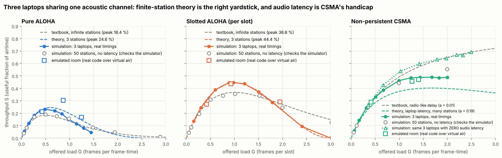

* **Pure ALOHA:** 3-station simulation peaks at **0.23**. Theory for N = 3 says 0.246; the textbook says 0.184.
* **Slotted ALOHA:** **0.447** per slot vs 0.444 theory for N = 3.
* The grey hollow circles (50 stations, no latency) sit on the textbook curves. This is our check that the simulator itself is right.
* **CSMA:** the same 3 laptops would reach **0.69** with zero audio latency, but only **0.49** with realistic latency. That gap is the cost of the sound card.
* **Squares (emulated room):** the *real* station and sink code, talking through the simulated room for 90 s per point. They agree with theory within the statistical spread of a 90 s run (about ±0.07; one point is only ~20 frames), and tend to sit above it: a very short overlap (the next frame's quiet preroll over the last bits of the previous one) doesn't destroy both frames, although theory assumes it does. Real laptops at different distances add the *capture effect* (the louder frame survives), so expect measured dots slightly above the dashed lines too.

### Figure 2: CSMA vs audio latency
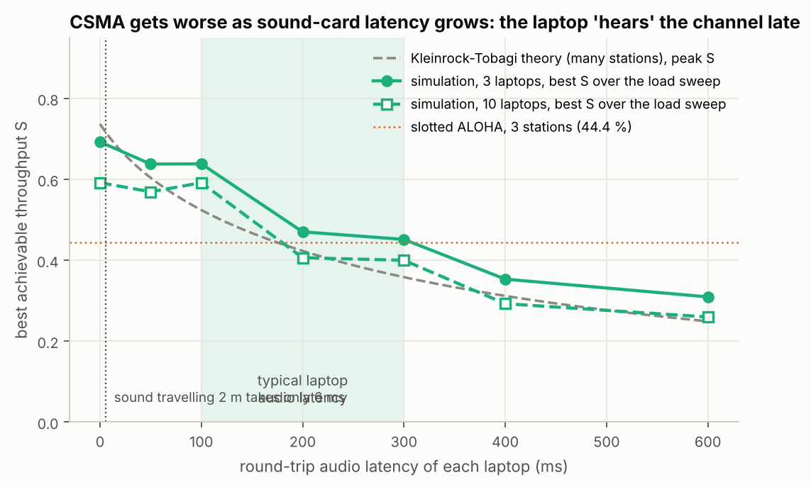

Best CSMA throughput falls from about **0.69** (0 ms) to **0.45** (300 ms) to **0.31** (600 ms). With 10 stations the simulation lands on the Kleinrock–Tobagi theory curve. At typical laptop latency (shaded), CSMA is barely better than Slotted ALOHA's 0.444.

### Figure 3: reliability protocols
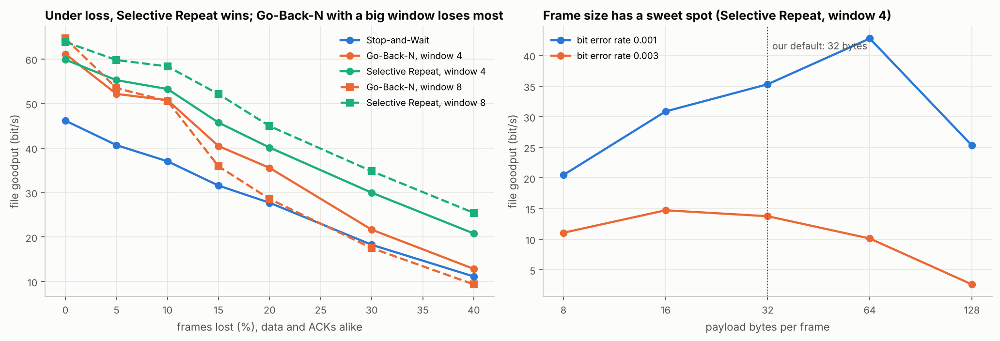

File goodput at the base speed (bit/s), 1280-byte file, 6 runs each:

| Frames lost | Stop-and-Wait | Go-Back-N, W=4 | Selective Repeat, W=4 | Go-Back-N, W=8 | Selective Repeat, W=8 |
|---|---|---|---|---|---|
| 0 % | 46 | 61 | 60 | 65 | 64 |
| 20 % | 28 | 36 | 40 | 29 | **45** |
| 40 % | 11 | 13 | 21 | 9 | **25** |

At 20 % loss, Go-Back-N with W = 8 resends **50** frames for a 40-chunk file; Selective Repeat W = 8 resends **11**. Right panel: frame size has a sweet spot that moves with the error rate: **64 bytes** at a bit error rate of 10⁻³, **16 bytes** at 3 × 10⁻³. Small frames waste time on preambles and headers; big frames get hit by errors more often. Our 32-byte default for the slow speeds sits between the two; the fast speeds use bigger frames.

### Figure 4: physical-layer robustness
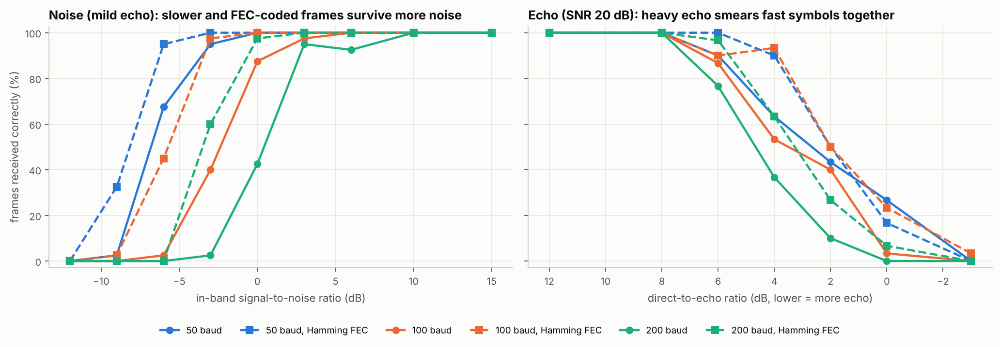

* **Noise (left):** every halving of the bit rate buys about **3 dB** (each bit gets twice the energy), and Hamming FEC buys about another **3 dB**. Half of the frames still get through at about +0.5 dB SNR at 200 baud, −2.5 dB at 100 baud and −6.5 dB at 50 baud.
* **Echo (right):** with strong echo (direct-to-echo ratio 4 dB), 50 baud still delivers **63 %** of frames but 200 baud only **37 %**. FEC lifts them to 90 % and 63 %. Long symbols let each echo die away before the next one, which is why `--baud 50` is the first thing to try in an echoey room.

### Figure 5: why CRC?
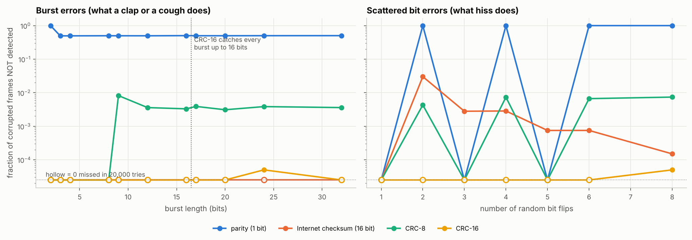

Out of **360,000** deliberately corrupted messages, **CRC-16 missed 2**. It missed **none** of the bursts up to 16 bits, as theory promises. The Internet checksum (used by IP/TCP/UDP) missed **3 %** of the 2-bit errors. Single parity misses every even number of flipped bits.

### Figure 7: the speed ladder and adaptive speed
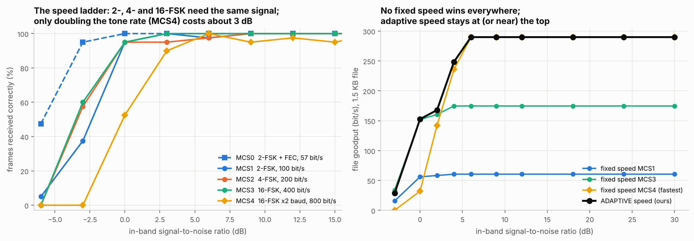

* **Left (40 frames per point, 32-byte payload):** MCS 1, 2 and 3 all deliver ≥ 95 % of frames from 0 dB upwards: 4-FSK and 16-FSK cost **nothing** in SNR while carrying 2× and 4× the bits. MCS 4 (half-length tones) needs about **3 dB more**. MCS 0 (FEC) still delivers 95 % at −3 dB.
* **Right (1.5 KB file, the real ARQ + rate-control code on VirtualNet, losses taken from the left panel):**

| In-band SNR | fixed MCS 1 | fixed MCS 3 | fixed MCS 4 | **adaptive** |
|---|---|---|---|---|
| −3 dB | 16 | **34** | 0 (fails) | 29 |
| 0 dB | 56 | 152 | 32 | **153** |
| 2 dB | 58 | 160 | 142 | **168** |
| 4 dB | 61 | 175 | 236 | **249** |
| ≥ 6 dB | 61 | 175 | **290** | **290** |

No fixed speed wins everywhere: MCS 4 is best in a quiet room and useless in a noisy one. Adaptive speed is the best or within 15 % of the best at every SNR, and on a clean channel it is **4.8× faster** than the base speed (290 vs 61 bit/s).

### Figure 8: a noisy fan switching on and off
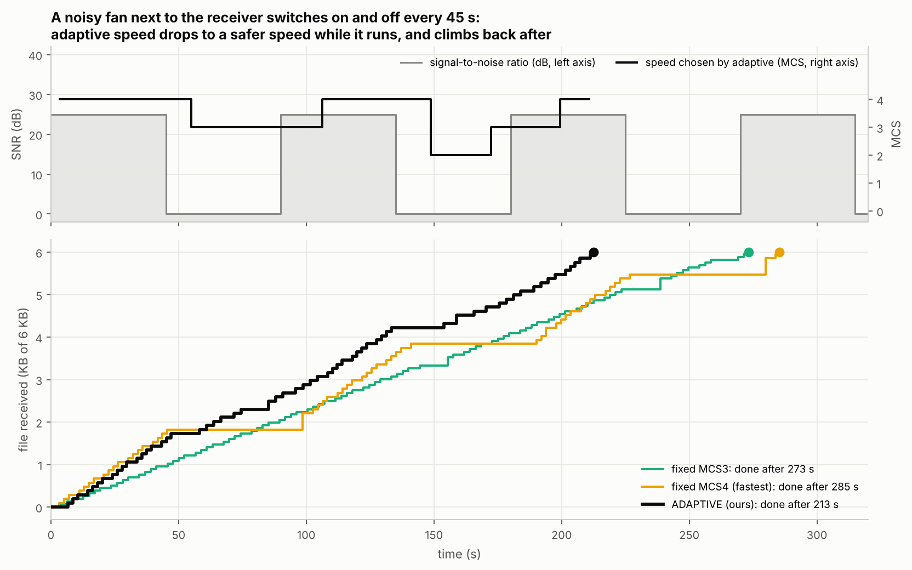

A 6 KB file while a fan next to the receiver switches on and off every 45 s (SNR 25 dB ↔ 0 dB). The fast fixed speed stalls whenever the fan runs; the robust fixed speed is slow all the time. Adaptive speed drops to MCS 3 or MCS 2 within 10–15 s of the fan starting (it has to see a lossy burst first) and climbs back after it stops:

| Strategy | Time for 6 KB |
|---|---|
| fixed MCS 1 (base speed) | 805 s |
| fixed MCS 4 (fastest) | 285 s |
| fixed MCS 3 | 273 s |
| **adaptive** | **213 s** (22 % sooner than the best fixed speed) |

### Figure 9: routing, convergence and count-to-infinity
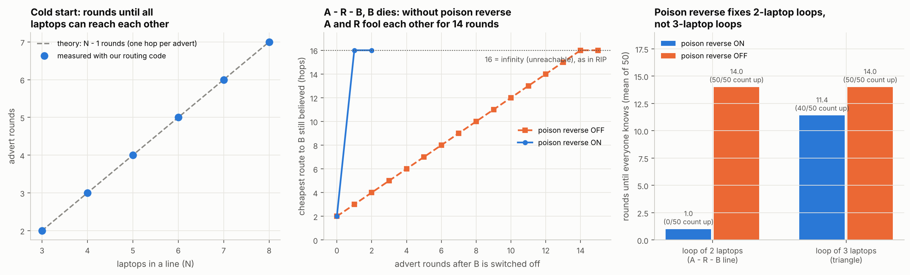

* **Left:** from a cold start, a line of N laptops needs exactly **N − 1** advert rounds until everyone can reach everyone: news travels one hop per advert.
* **Middle:** in A – R – B, B is switched off. Without poison reverse, A and R keep learning the dead route from each other, one hop longer each time, and need **14 rounds** to reach 16 (infinity). With poison reverse: **1 round**.
* **Right (50 random orders each):** poison reverse fixes the 2-laptop loop in **50 of 50** runs. In a triangle (a loop of 3) it still counts to infinity in **40 of 50** runs (11.4 rounds on average). With our 20 s advert period, 14 rounds is almost **5 minutes** of frames sent towards a dead laptop. This is exactly the limitation the textbooks warn about, and why real protocols add hold-down timers or switch to link-state routing.

### What the dashboards look like

The three backup scenarios (`sim-demo --scenario speed | security | relay`), as the projector shows them:

| Adaptive speed (fan on) | Eve: stolen file vs encrypted file | Relay: routing tables and traceroute |
|---|---|---|
| 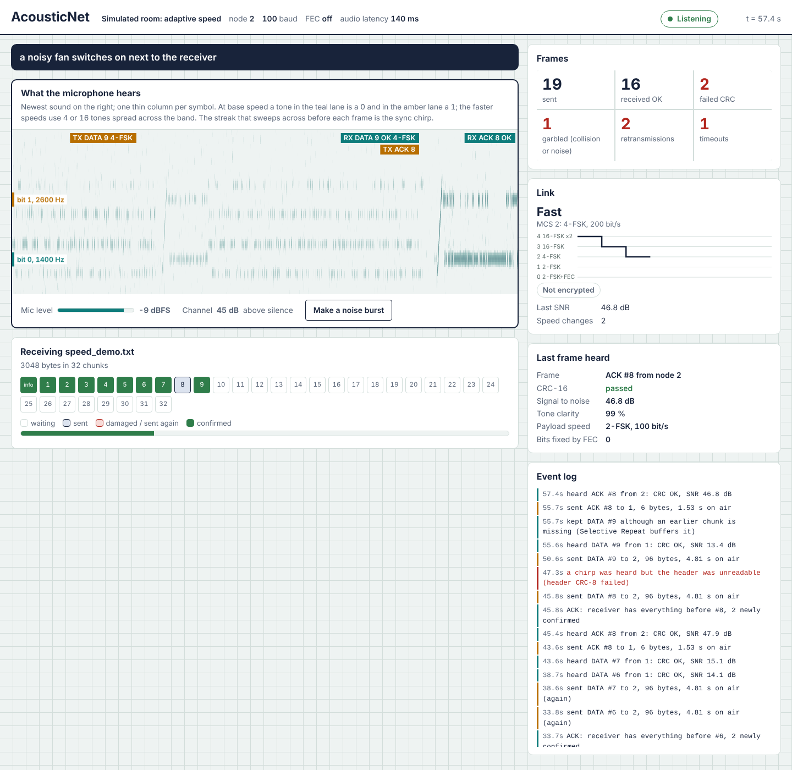 | 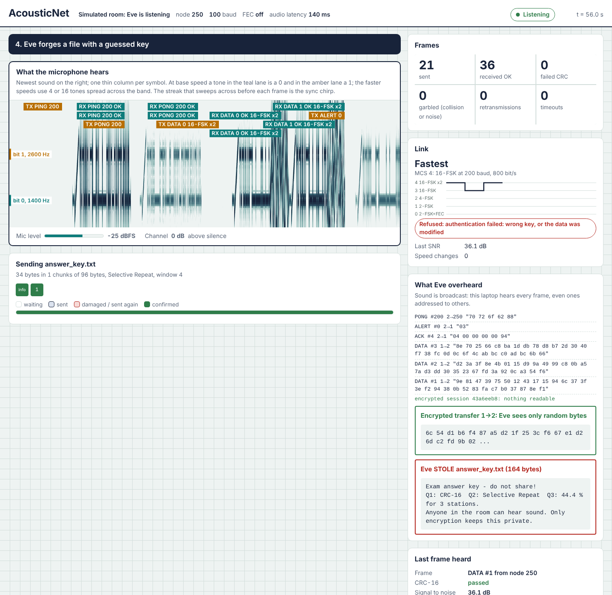 | 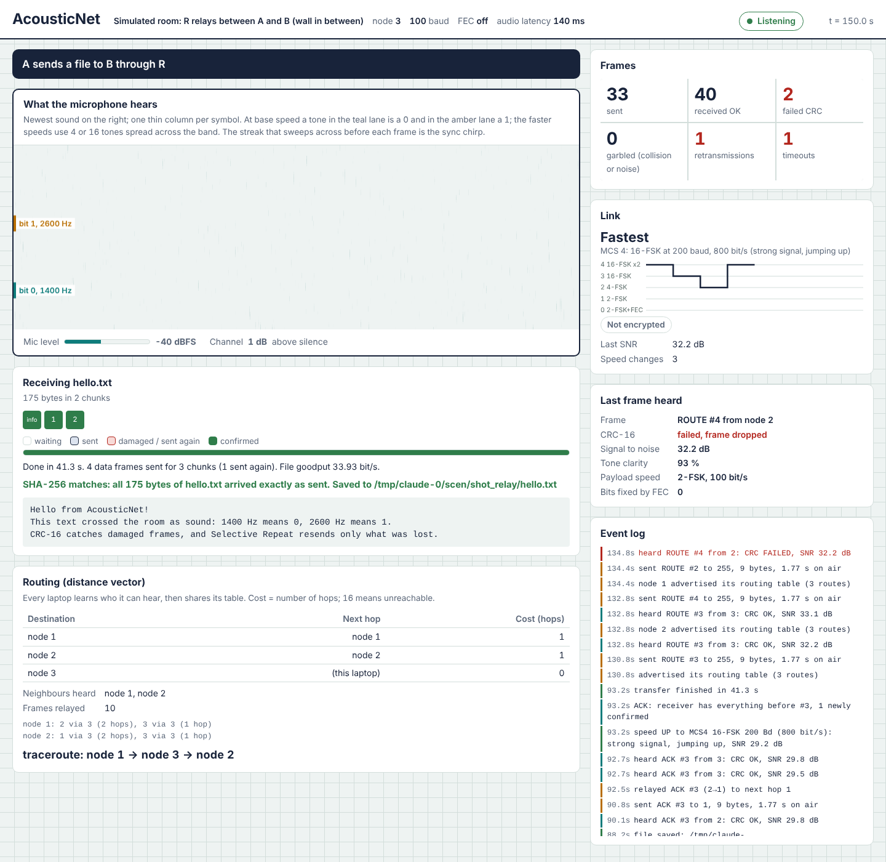 |

### Key numbers

| Quantity | Value |
|---|---|
| Raw bit rate | 57 / 100 / 200 / 400 / 800 bit/s (MCS 0–4); base 100 (25 / 50 / 200 baud also supported) |
| DATA frame, 32 bytes, base speed | 3.61 s on air (6.07 s at MCS 0) |
| DATA frame, 96 bytes, MCS 4 | 1.87 s on air |
| ACK frame | 1.21 s (Go-Back-N) / 1.53 s (Selective Repeat, with bitmap and SNR) |
| File goodput, base speed (no loss) | 46–65 bit/s depending on protocol |
| File goodput, adaptive, clean channel | about 290 bit/s |
| Security overhead | 6-byte tag per message; 4-byte session id once per file |
| Relay | every frame is on air twice (store-and-forward on one shared channel), so a relayed file takes at least twice as long |
| Receiver speed | about 150× real time |
| Automated tests | 75, all passing |

---

## 6. Every file in the folder and why it exists

```
AcousticNet/
├── README.md                 this guide
├── requirements.txt          Python libraries to install
├── .gitignore                which generated files git should ignore
├── acousticnet/              THE NETWORK STACK (a Python package)
├── experiments/              scripts that produce the result tables and figures
├── results/                  the result tables (CSV), figures and dashboard screenshots (PNG)
├── demo_files/               small files to send in the demo
└── tests/                    automated tests (75)
```

### `acousticnet/` (the stack, bottom to top)

| File | Layer | Why it exists |
|---|---|---|
| `__init__.py` | – | Makes the folder a Python package; its docstring is a map of the layers |
| `__main__.py` | – | Makes `python -m acousticnet <command>` work |
| `config.py` | all | **Every tunable number** in one place (tones, baud, chirp, timers), the rule that rejects tones without whole cycles per symbol, the **speed table** (MCS 0–4) with its measured SNR thresholds, and the chunk size per speed |
| `coding.py` | data link | Bits/bytes helpers, **CRC-16, CRC-8**, Internet checksum and parity (for the comparison), **Hamming(7,4)**, **interleaver** |
| `frame.py` | data link | The **frame format**: the 7-byte header (with the MCS byte), frame types, flags, the two sync words, building and parsing frames |
| `phy.py` | physical | The **modem**: 2-, 4- and 16-FSK modulation, chirp, preroll, band-pass, matched filter, tone-energy demodulation, symbol-timing search, `decode_at()` (header at base speed, payload at the announced speed) |
| `receiver.py` | physical | **RingBuffer** (stored microphone audio with absolute indices) and **StreamReceiver** (finds frames in endless audio, incrementally) |
| `channel.py` | physical (model) | Maths of a room for experiments: in-band noise, synthetic echo (room impulse response), latency |
| `audio.py` | hardware | **AudioBackend** (full-duplex sound card; the sample counter is the clock; scheduled transmissions) and **SimAir** (virtual room that drives the same callback; walls, changing noise) |
| `link.py` | node | **Node**: one laptop. `send` (at any speed), `recv` (with honest timeouts), carrier sense, noise floor, ACK-timeout formula, promiscuous mode, emulated "wall" (`--ignore`) |
| `rate.py` | data link | **RateController**: adaptive speed (ARF + SNR-guided jumps) |
| `arq.py` | data link (LLC) | **Stop-and-Wait, Go-Back-N, Selective Repeat** with burst + POLL, block-ACK bitmap, SNR in every ACK, status polls, ALERT codes, rate-control hooks |
| `mac.py` | data link (MAC) | **ALOHA / Slotted ALOHA / CSMA** experiment: `MacStation`, `MacSink`, START/REPORT messages, timing advance, sweep to CSV |
| `network.py` | network | **Distance-vector routing** (`DVTable`), the **Router** (adverts, timeouts, forwarding, TTL), **NetLink** (multi-hop link for ARQ) and **traceroute** |
| `crypto.py` | application (security) | **SecureChannel**: PBKDF2 key derivation, HMAC-counter-mode encryption, encrypt-then-MAC tags, session nonces |
| `sniffer.py` | application (attack) | **Eve**: promiscuous listener that rebuilds unencrypted files, records every transfer, and `load_capture()` for the replay attack |
| `theory.py` | – | Textbook and finite-station throughput formulas (ALOHA, slotted, Kleinrock–Tobagi CSMA) |
| `transfer.py` | application | **File transfer** (META + chunks + SHA-256, link probe, encryption, replay log, refusal with ALERTs, safe file names, linger) and **acoustic ping** |
| `bertest.py` | measurement | **Bit-error-rate test**: reproducible pseudo-random frames, so even CRC-failed frames can be compared bit by bit |
| `diagnostics.py` | tools | **Self-test** (silence, latency, tone stability, loopback with and without FEC) and the calibration file |
| `events.py` | tools | **Event bus**: every layer reports what it does; console printer and CSV logger subscribe to it |
| `virtual.py` | tools | **VirtualNet**: a frame-level fake link with *virtual time* and speed-dependent losses, so ARQ and rate control run thousands of times faster |
| `scenarios.py` | tools | The four **simulated-room demos**: `basic`, `speed` (fan on/off), `security` (Eve), `relay` (wall + relay) |
| `dashboard.py` | tools | Tiny **web server** (standard library only): page, live event stream (SSE), spectrogram sampler, actions |
| `cli.py` | tools | **All commands** (`selftest`, `send`, `recv`, `ping`, `traceroute`, `relay`, `sniff`, `replay`, `mac-sink` and so on) and their options |
| `web/index.html` | tools | The **dashboard page**: spectrogram, counters, chunk grid, speed panel, Eve's view, routing tables, event log, MAC chart. Self-contained, because Wi-Fi is off during the demo |

### `experiments/`

| File | Why it exists |
|---|---|
| `phy_sim.py` | Frame success vs noise and vs echo (3 baud rates × FEC on/off), and **per speed** (MCS 0–4) with the header SNR the receiver measures; prints the thresholds for `config.py` → `results/sim/phy_sim.csv` |
| `rate_sim.py` | Fixed speeds vs adaptive speed: steady SNR sweep and the fan on/off timeline, using the real ARQ + rate-control code on VirtualNet → `rate_sim.csv` |
| `arq_sim.py` | Goodput vs loss for the 5 ARQ configurations, and goodput vs frame size, using the real ARQ code on VirtualNet → `arq_sim.csv` |
| `mac_sim.py` | Event simulation of the MAC experiment (lab N = 3, the N = 50 check, latency sweep) → `mac_sim.csv` |
| `routing_sim.py` | Convergence and count-to-infinity with the real `DVTable`, random advert order → `routing_sim.csv` |
| `errdetect_sim.py` | Parity vs Internet checksum vs CRC-8 vs CRC-16 on 360,000 corrupted messages → `errdetect_sim.csv` |
| `plot_results.py` | Draws Figures 1–9 from all the CSVs; automatically includes your measured CSVs |

### `results/`

| Path | Why it exists |
|---|---|
| `sim/*.csv` | Raw numbers behind every figure, so anyone can check them |
| `sim/mac_emulated.csv` | MAC experiment run by the **real** station/sink code inside the virtual room (the square markers in Fig. 1) |
| `figures/fig1…fig9*.png` | The report figures (fig6 appears once you measure BER on laptops) |
| `screenshots/*.png` | The dashboard during the three backup scenarios, for slides and the report |
| `measured/` *(created when you run hardware experiments)* | `ber_measured.csv`, `mac_measured.csv`: **your** real measurements |

### `demo_files/`

| File | Why it exists |
|---|---|
| `hello.txt` (98 B) | Quick transfer, about 25 s at base speed |
| `secret_message.txt` (202 B) | Main demo file; long enough for a clap to hit a chunk |
| `tiny_logo.png` (178 B) | Shows that **binary** data works: a picture sent by sound that opens as an image afterwards |
| `exam_answers.txt` (164 B) | The "secret" that Eve steals in the security act |
| `forged_message.txt` (69 B) | What Eve tries to slip in with a guessed key |

### `tests/` (run with `python -m pytest -q`)

| File | What it proves |
|---|---|
| `test_coding.py` | CRCs match the standard check values; Hamming fixes every single-bit error; interleaving + Hamming fixes bursts; header/body CRCs catch corruption; frames round-trip at every speed |
| `test_phy.py` | Tones of every speed are orthogonal; invalid baud is rejected; frames at every speed survive a noisy echoey room; streaming receiver finds every frame; noise gives no false frames |
| `test_arq.py` | All 5 ARQ configurations deliver byte-exact files at up to 35 % loss; sequence numbers wrap past 255; Selective Repeat retransmits less than Go-Back-N |
| `test_rate.py` | Every rate-control rule (step up, jump up, step down, jump down, two-silence fallback); the speed table is sane; adaptive beats base speed by 3× on a good channel; adaptive survives a noisy spell and speeds up again |
| `test_security.py` | Encrypt/decrypt round trip; wrong key, tampering and wrong nonce are detected; encrypted transfer works and wrong keys are refused with an ALERT; a replayed session is refused; Eve steals plain files but not encrypted ones; Eve's own recording, replayed as Alice, is refused |
| `test_routing.py` | A line converges; poison reverse stops count-to-infinity (and without it the cost counts up); a full relayed transfer through a wall in the simulated room: route cost 2, traceroute `[3, 2]`, file intact |
| `test_mac.py` | Theory peaks (18.4 / 36.8 / 24.6 / 44.4 %); the event simulator reproduces the textbook with 50 stations and the 3-station theory; START/REPORT messages; a short CSMA run of the real station/sink code in the virtual room |
| `test_simulated_room.py` | Full stack over SimAir: file transfer with a noise burst, ping, FEC at 200 baud, carrier sense |
| `test_backend.py` | Real sound-card code path with a fake `sounddevice`: latency measured exactly, stereo fallback, self-test READY, scheduled transmission starts on the exact sample |
| `test_cli.py` | The real commands exactly as typed: `recv`, `send` and `ping` on two laptops; and on three laptops `recv --key`, `send --key` and `sniff`, then Eve's `replay` of her recording is refused |

### Files that appear when you use it (not shipped)

| File | Why |
|---|---|
| `acousticnet_calibration.json` | Written by `selftest`: this laptop's audio latency; read by every command |
| `received/` | Files that arrived by sound; also `.acousticnet_sessions`, the list of completed encrypted sessions (replay protection) |
| `sniffed/` | Eve's haul: `stolen_*` files and `capture_*.json` recordings |
| `__pycache__/`, `.pytest_cache/` | Python's own caches; safe to delete |

---

## 7. Setup

You need **Python 3.9 or newer** on every laptop. Open a terminal **inside the `AcousticNet` folder** for every command.

```bash
pip install -r requirements.txt
python -m acousticnet selftest
```

(On Windows, if `python` isn't found, use `py` instead: `py -m pip install -r requirements.txt`, `py -m acousticnet selftest`.)

### Switch off the "helpful" audio processing (the #1 cause of failure)

Operating systems try to remove "noise" from microphones, and a steady tone looks like noise to them. `selftest` detects this: *"tone faded while it was still playing"*.

**Windows 10/11**
1. Settings → System → Sound → your **microphone** → Properties: turn **Audio enhancements** off, and set input volume to about **70–80**.
2. Same for the **speaker**: Audio enhancements off.
3. Control Panel → Sound → *Communications* tab → **Do nothing**, so Windows doesn't duck the volume.
4. Settings → Privacy & security → Microphone → allow **desktop apps** to use the microphone.
5. Some laptops (Realtek, Dolby, Waves MaxxAudio, "Voice Clarity") have their own noise-suppression app. Turn it off there too.

**macOS**
1. System Settings → Sound → Input: input volume about 70 %.
2. Control Centre → **Mic Mode → Standard** (not *Voice Isolation*).
3. Allow **Terminal** to use the microphone when macOS asks.

**Linux**
1. `sudo apt install libportaudio2`
2. Don't load PulseAudio/PipeWire **echo-cancel** modules.

**Volume:** system volume about **70 %**. If `selftest` says *clipping*, use `--volume 0.5`.

---

## 8. How to demonstrate the project

> **Honest status.** Every feature runs end to end in the simulated room and in the automated tests. The single-link features (transfer, clap, Go-Back-N, ping) were designed around real laptops from day one. Adaptive speed, Eve and the relay are new: **rehearse them on your own laptops** the day before (8.2), because real rooms differ. If one misbehaves on the day, its `sim-demo` scenario is the backup (8.5).

### 8.1 What you need

* **Two laptops** for the core demo; a **third** laptop for Eve and for the relay (the relay can reuse Eve's laptop). Four laptops allow a live MAC run (3 stations + 1 sink).
* Chargers. Laptops on battery saver can reduce audio quality.
* A projector, connected to the **receiver** laptop (it shows the dashboard).
* A **phone** that can play white noise or loud music (for the adaptive-speed act).
* A phone with a **backup video** of a successful run. Every good demo team has one.
* A reasonably quiet corner. A noisy lab is fine; that's what CRC, ARQ and adaptive speed are for.

### 8.2 The day before

1. Install and run `selftest` on every laptop; all must say **READY**.
2. Rehearse the full script twice, including the clap, the noise phone, Eve and the relay. Note which acts work reliably in *your* room.
3. Run `python -m acousticnet plot` and put the figures on slides.
4. Record the backup video of the full demo.
5. Decide roles (8.6).

### 8.3 Ten minutes before evaluators arrive

```bash
# every laptop
python -m acousticnet selftest

# receiver laptop (B, on the projector)
python -m acousticnet recv

# sender laptop (A): quick check that they hear each other
python -m acousticnet ping
```

* Place A and B **0.5–1 m apart**, speakers facing the other laptop's microphone.
* If `ping` replies, you're ready. If not, see the troubleshooting table (8.7).
* Leave `recv` running on B with the dashboard full-screen.

### 8.4 The live demo script

The core (Acts 1–4) takes about 8 minutes; each upgrade act adds about 3. For a 10-minute slot do Acts 1–3, then pick **one** of Acts 5–7 (Eve is the most memorable).

`send` and `replay` keep their dashboard open when they finish, and `recv`, `relay` and `sniff` run until stopped. Press **Ctrl+C** before the next command on the same laptop (or add `--no-wait` to `send` and `replay`).

**Act 1, 0:00. Opening line (Person 2)**
> "This is AcousticNet. These laptops have no Wi-Fi, no Bluetooth and no cable. Everything you'll see travels through the air as sound, and we built every layer that makes it work: the modem, error control, retransmission, adaptive speed, routing and encryption."

Turn on airplane mode on every laptop and show it. Run `ping google.com` in a terminal: it fails.

**Act 2, 1:00. Dashboard tour, then send a file (Person 2 narrates, Person 1 types on A)**
* *"This is what the receiver's microphone hears. At base speed the teal lane is a 0, the amber lane a 1, and each thin column is one symbol."*

```bash
python -m acousticnet send demo_files/secret_message.txt --rate base
```
(`--rate base` keeps it at 100 bit/s, so every bit is visible.) While it plays:
* the sweeping streak before every frame is the **sync chirp**;
* each label "RX DATA n OK" is one frame decoded with a correct CRC; each square is a **chunk** and turns green when it arrives;
* after every 4 frames the receiver answers with **one ACK**: a half-duplex burst, like Wi-Fi Block-ACK.

**Act 3, 2:30. The clap (Person 1 or 3)**
Run the same command again. Right after the screen shows **"RX DATA 1 OK"** (so DATA 2 is now playing), **clap two or three times right next to laptop B's microphone**, or play music from a phone for a second.
* **"RX DATA 2 CRC FAIL"** appears in red, and chunk 2 turns red. CRC-16 detected the damage and the frame was thrown away.
* Chunks 3 and 4 still turn green: Selective Repeat **keeps** out-of-order frames.
* The ACK tells the sender "missing #2". Only DATA 2 is sent again. *"Only what was lost is resent."*
* The dashboard ends with **"SHA-256 matches: all 202 bytes arrived exactly as sent"**.

If the clap misses (FSK is surprisingly tough), clap again during the next frame. A phone playing music at full volume 10 cm from the microphone always works.

*(Optional, 1 min) Go-Back-N contrast:* press **Ctrl+C** on A, then `python -m acousticnet send demo_files/hello.txt --rate base --arq gbn` and clap during DATA 1. The chunks after the damaged one stay **empty**: Go-Back-N throws them away and resends them all.

**Act 4, 4:30. Acoustic ping (Person 1)** (Ctrl+C the previous `send` first)
```bash
python -m acousticnet ping
```
> "Round trip about 3.5 to 4 s: 2.8 s is the PING and PONG themselves at 100 bit/s, the rest is the two sound cards' latency plus processing. That latency turned out to be our most interesting MAC finding."

**Act 5, about 3 min. Adaptive speed (Person 1 on A, Person 3 with the noise phone next to B)**
```bash
python -m acousticnet send demo_files/secret_message.txt
```
(no `--rate`: adaptive is the default.)
* The **Link** panel on the projector: in a quiet room the probe picks **Fastest, MCS 4, 800 bit/s**; the tone lanes now show **16 tones** instead of two. *"Same idea as Wi-Fi: when the channel is clean, pack 4 bits into every tone."*
* Person 3 starts **white noise** on the phone 20–30 cm from B's microphone. Within a burst or two, the speed steps **down** (the event log says why: *"3 of 4 frames lost"*, *"SNR too low"*), and the frames keep arriving.
* Stop the noise. After the next clean burst the speed **jumps back up** (*"strong signal, jumping up"*).
* Point at Fig. 7: *"16-FSK needs no more signal than 2-FSK; only the faster tone rate costs SNR. No fixed speed is best everywhere, so the link adapts."*

If the room is so quiet that nothing changes, hold the phone closer, or show `sim-demo --scenario speed`.

**Act 6, about 4 min. Eve the eavesdropper (third laptop C)**

On C (turn its screen to the audience, or put it on the projector):
```bash
python -m acousticnet sniff
```
1. **Plain file.** On B: Ctrl+C, then `python -m acousticnet recv`. On A: `python -m acousticnet send demo_files/exam_answers.txt`. Eve's dashboard shows **"Eve STOLE exam_answers.txt"** with the full text. *"Sound is broadcast: everyone hears everything."*
2. **Encrypted file.** On B: Ctrl+C, then `python -m acousticnet recv --key vit-cn-lab`. On A: `python -m acousticnet send demo_files/exam_answers.txt --key vit-cn-lab`. B shows the file and *"Encrypted + authenticated"*; Eve sees only **random bytes**. C's terminal prints the recording it made: `SNIFF_CAPTURE ... path=sniffed/capture_1_to_2_<session>.json`.
3. **Replay attack.** Wait until at least 20 s after A printed "Done" (B keeps re-answering its sender for 20 s in case its last ACK was lost, so an earlier replay is simply re-ACKed). On C: Ctrl+C, then `python -m acousticnet replay sniffed/capture_1_to_2_<session>.json` (Eve pretends to be laptop 1 and plays back exactly what she heard). B answers **"replay attack refused: this session was already received"**.
4. **Forgery.** On C: `python -m acousticnet send demo_files/forged_message.txt --addr 250 --key password123`. B answers **"authentication failed: wrong key, or the data was modified"**.

> "Confidentiality, integrity and freshness: the three things TLS gives a web page, here on a channel the whole room can hear."

**Act 7, about 3 min. The relay (three laptops in a row: A, R, B)**

If the room is big, place A and B so far apart (or behind a wall/door) that `ping` fails between them. In a small room, **emulate the wall** with `--ignore` (A and B pretend not to hear each other).
```bash
# B (projector):
python -m acousticnet recv --routed --ignore 1
# R (in the middle):
python -m acousticnet relay
# A:
python -m acousticnet traceroute --to 2 --ignore 2
python -m acousticnet send demo_files/hello.txt --routed --ignore 2
```
* The **Routing** panel fills in: neighbours, then *"node 1 via node 3, 2 hops"*. Adverts are spread out randomly, so allow up to a minute.
* `traceroute` prints **`1 -> 3 -> 2`**: the TTL = 1 ping dies at R, which sends "time exceeded" back; the TTL = 2 ping reaches B.
* The file arrives at B, relayed by R (R's screen counts *"Frames relayed"*).
* Point at Fig. 9: *"distance-vector routing has a famous weakness, count-to-infinity; here is ours, measured, and here is the case poison reverse can't fix."*

**Closing line, about 30 s (Person 3, with the result slides)**
> "We built a complete network stack on the worst medium we could find, made it reliable, fast where possible, secure and multi-hop, and measured it against theory, including two effects the textbook doesn't mention: sound-card latency handicaps CSMA, and 16-FSK costs no more signal than 2-FSK."

### 8.5 Backup plans

| Problem on the day | Plan B |
|---|---|
| A laptop's audio misbehaves | `python -m acousticnet sim-demo`: the core demo in the simulated room on one laptop; the dashboard has a **"Make a noise burst"** button instead of a clap |
| Adaptive speed doesn't change in your room | `python -m acousticnet sim-demo --scenario speed` (a simulated fan switches on at 25 s and off at 60 s) |
| No third laptop, or Eve's laptop hears too little | `python -m acousticnet sim-demo --scenario security` (all four steps, with Eve's dashboard) |
| The relay doesn't converge in time | `python -m acousticnet sim-demo --scenario relay` (a wall between A and B, R relays) |
| Room too noisy | add `--baud 50` (every laptop) or `--fec` (every laptop) |
| Nothing works | play the backup video and present the graphs |
| Dashboard doesn't open | the terminal prints everything too; or open `http://127.0.0.1:8765` manually |

Add `--speed 2` to any `sim-demo` to run it twice as fast.

### 8.6 Roles for a team of three

| Person | Before | During |
|---|---|---|
| 1 | sender laptop A, self-tests | runs `send` / `ping` / `traceroute`, does the clap |
| 2 | receiver laptop B + projector | narrates the dashboard |
| 3 | laptop C (Eve / relay), noise phone, slides, backup video | runs Eve and the relay, presents results, leads the Q&A |

### 8.7 Troubleshooting

| Symptom | Cause | Fix |
|---|---|---|
| `selftest`: "own chirp not heard" | volume too low, mic muted, or the laptop cancels its own sound | raise volume, check mic permission. If two-laptop `ping` works, it's fine |
| "tone faded while it was still playing" | OS noise suppression / AGC | section 7: turn enhancements off |
| "clipping" | too loud | `--volume 0.5` |
| frames heard but CRC fails often | echo or noise | move closer, `--rate 0` (most robust speed), `--baud 50` or `--fec` (on **every** laptop) |
| adaptive speed keeps falling to MCS 0 | weak or echoey link | move closer; or demonstrate with `--rate 3` (16-FSK is as robust as 2-FSK) |
| nothing received at all | wrong device | `python -m acousticnet devices`, then `--device N` |
| "Invalid sample rate" | device doesn't do 48 kHz | `--fs 44100` (baud 25/50/100) |
| many timeouts | latency longer than calibrated | run `selftest` again on every laptop |
| "the file is encrypted and the receiver has no key" | B runs `recv` without `--key` | restart B with the same `--key` as A |
| "unencrypted file refused" | B runs with `--key`, A without | add `--key` on A, or restart B without it |
| relay: "no route to node 2" for a long time | adverts collided, or R can't hear one side | wait 30–60 s; check `ping` A↔R and R↔B; move R |
| `ModuleNotFoundError: acousticnet` / `No module named acousticnet` | terminal not inside the project folder, or the package folder was renamed (Python imports are case-sensitive, even on Windows) | `cd` into the project folder; the package folder inside it must be named exactly `acousticnet` (lowercase) |

---

## 9. How to produce your own measured results

Do these after the core demo works. Every command appends to a CSV in `results/measured/`; then run `python -m acousticnet plot`.

**A. Bit error rate vs distance (about 15 min)**
```bash
# laptop B (receiver), once per distance:
python -m acousticnet ber-rx --distance 0.5
# laptop A (sender), after B is listening:
python -m acousticnet ber-tx
```
Repeat at 0.5, 1, 2 and 3 m. Then repeat with `--baud 50` on both, and with `--fec` on both. This creates **Figure 6**.

**B. ARQ comparison (about 15 min).** Send `demo_files/secret_message.txt` three times each with `--rate base --arq sw`, `--arq gbn` and `--arq sr`, clapping at the same moment each time. Note the "Done: … goodput …" line and make a small table. Add `--log results/measured/arq_events.csv` to keep every event.

**C. Speeds on real laptops (about 15 min).** At 1 m and at 3 m, send `demo_files/secret_message.txt` with `--rate 1`, `--rate 3`, `--rate 4` and adaptive (no `--rate`). The "Done" line prints goodput and *frames per speed*. This is the hardware version of Fig. 7 (right).

**D. Shared channel (about 30 min, 4 laptops)**
```bash
# three station laptops:
python -m acousticnet mac-station --addr 1     # 2 and 3 on the others
# sink laptop (in the middle):
python -m acousticnet mac-sink --duration 90
```
The sink runs 3 protocols × 5 loads = 15 runs automatically and writes `results/measured/mac_measured.csv`. With only 3 laptops, use 2 stations: `mac-sink --stations 1,2`.

**E. Draw everything:** `python -m acousticnet plot`. Your measured points appear as big filled dots in Figure 1, and Figure 6 is created.

---

## 10. Syllabus mapping

| Module | Topic | Where in AcousticNet |
|---|---|---|
| 1 | Communication model, layered architecture, topology, data flow | Layer stack (3.0); the air is a **shared bus**; **half-duplex** data flow; a relay makes a **line topology** |
| 2 | Data rate, modulation, transmission impairments, performance | **2/4/16-FSK**, **baud vs bit rate vs goodput**, **Shannon-style trade of bandwidth for power** (Fig. 7); **attenuation, noise, echo** (Fig. 4); latency/RTT (ping) |
| 3 | Error detection & correction | **CRC-16, CRC-8, checksum, parity** (Fig. 5); **Hamming(7,4)** + interleaving |
| 3 | Flow control | **Stop-and-Wait, Go-Back-N, Selective Repeat** (Fig. 3) |
| 3 | Multiple access | **ALOHA, Slotted ALOHA, CSMA** (Figs. 1–2); why **CSMA/CD** is impossible here; 802.11 parallels (Block-ACK, rate adaptation, PLCP rate field) |
| 4 | Addressing, header formats | 8-bit link addresses, broadcast address, header checksum (like IPv4); **network header** with TTL inside routed frames |
| 5 | Routing | **Distance-vector routing** (Bellman–Ford / RIP), poison reverse, **count-to-infinity** (Fig. 9), triggered updates, timeouts, **TTL, ICMP-like time-exceeded, traceroute**, store-and-forward |
| 6 | Transport: reliability, timers, congestion, QoS | sequence numbers, windows, retransmission timers, TIME_WAIT-like linger; adapting the sending rate to the channel; throughput/delay |
| 7 | Application layer | file transfer (FTP-like), ping (ICMP-like); **TLS-like security** at the application layer |
| 8 | Contemporary issues | data-over-sound, **air-gapped communication and its eavesdropping risk**, device pairing |

---

## 11. Viva questions and answers

**Physical layer**

**Why sound?**
It's a real, shared, noisy, half-duplex medium we can build every layer for, using only laptops. It makes every syllabus problem visible and audible.

**Why FSK and not ASK or PSK?**
ASK needs the exact loudness, which changes with distance and auto-gain. PSK needs the exact phase, which echo scrambles. FSK only asks which tone is loudest.

**Why 1400 and 2600 Hz?**
Whole cycles per symbol makes them orthogonal. They aren't harmonics of each other. They're valid at 25–200 baud. They're in the laptop speaker's sweet spot.

**What is the chirp for?**
Detection and timing. Its sharp correlation peak tells us exactly where the frame starts, even in noise.

**Why does 16-FSK not need more SNR than 2-FSK?**
At the same tone length every tone has the same energy, but a 16-FSK tone carries 4 bits, so each bit gets 4× the energy. That outweighs having 16 tones to tell apart. The price is bandwidth: 16 tones instead of 2. MCS 4 halves the tone length, which halves the energy, so it does cost about 3 dB.

**How does the receiver know what speed a frame uses?**
The 7-byte header is always sent at the base speed and contains an MCS byte; after the header the receiver switches to that speed. The header's own CRC-8 makes sure we trust that byte. Wi-Fi's PLCP header does the same with its SIGNAL field.

**Why sample at 48 kHz?**
It's the native rate of most laptop audio. Our highest frequency is 3.8 kHz, far below the Nyquist limit of 24 kHz.

**How much bandwidth do you use?**
About 1.2 kHz for 2-FSK (1400 to 2600 Hz plus a little around each tone), up to about 3 kHz (800 to 3800 Hz) for MCS 4.

**Data link**

**Why does the header have its own CRC?**
To trust LEN and MCS before waiting for the body (same reason as IPv4's header checksum).

**CRC vs checksum?**
Fig. 5: CRC-16 catches every burst up to 16 bits. The Internet checksum missed 3 % of 2-bit errors.

**How does Hamming find the error?**
3 parity checks over overlapping bit groups; the 3-bit syndrome *is* the error's position.

**Why burst + POLL instead of an ACK per frame?**
Half-duplex: a laptop can't hear while it's talking. It's the same idea as 802.11n Block-ACK.

**Why is Selective Repeat's window limited?**
With 8-bit sequence numbers, W ≤ 128. Otherwise a new frame #5 and an old #5 look the same. We use ≤ 32 because of the 32-bit bitmap.

**What if the last ACK is lost?**
The sender sends a status poll; the receiver lingers to answer it (like TCP TIME_WAIT).

**Why is Stop-and-Wait slow?**
Efficiency = T<sub>frame</sub> / (T<sub>frame</sub> + T<sub>ACK</sub> + 2 × latency + processing). With 3.6 s frames, a 1.2 s ACK and two sound-card delays, almost half of the time is spent waiting (46 bit/s out of 100).

**Adaptive speed**

**Why not always use the fastest speed?**
Its frames need a cleaner signal. In noise they're lost, and every loss costs a whole retransmission round. Fig. 7: fixed MCS 4 fails at −3 dB where adaptive still delivers.

**How does the sender know the channel quality?**
The link probe (PING/PONG with the SNR each side heard) before the transfer, then the SNR in every ACK and the losses it sees.

**How does this compare with Wi-Fi?**
Wi-Fi's ARF steps down after failures and up after successes; SNR-based schemes (like RBAR) use the receiver's SNR; Linux's Minstrel samples rates statistically. Ours combines ARF with SNR-guided jumps.

**Why are the chunks bigger at high speed?**
The preamble and the header are always sent at base speed (about 0.7 s per frame). At 800 bit/s a 32-byte payload would take only 0.3 s, so most of the airtime would be overhead. Bigger payloads amortise it, which is Wi-Fi's frame aggregation.

**MAC**

**Why aren't your ALOHA peaks 18.4 % and 36.8 %?**
Those assume infinite stations. For N = 3 the theory gives 24.6 % and 44.4 %.

**What is *a* in CSMA, and why does it matter?**
Sensing delay ÷ frame time. On laptops it's dominated by sound-card latency (~0.19), so CSMA loses most of its advantage (Fig. 2).

**How do the slots line up without a shared clock?**
Everyone hears the START frame end at the same time. Each laptop then schedules its sound *rt* early (GSM-style timing advance).

**Why not CSMA/CD?**
A laptop can't hear others while its own speaker is on, so it can't detect a collision. That's why Wi-Fi uses CSMA/CA too.

**Network layer**

**How does distance-vector routing work?**
Each router tells its neighbours its cost to every destination; a neighbour adds one hop. After N − 1 rounds a line of N routers has converged (Fig. 9). This is Bellman–Ford, as in RIP.

**What is count-to-infinity?**
When a destination dies, two routers can keep learning the stale route from each other, each time one hop longer, until the cost reaches "infinity" (16). Fig. 9 shows 14 rounds.

**What does poison reverse do, and what can't it do?**
If my route to D goes through you, I advertise D to you as unreachable, so you never route D back through me. That breaks loops of two routers, but not loops of three: in our triangle it still counts up in 40 of 50 runs.

**What is a hidden terminal?**
A and B can't hear each other but both reach R. If they transmit at the same time, they collide at R and neither notices. We reduce it with jittered adverts and quiet-when-busy; RTS/CTS would be the next step.

**How does traceroute work?**
Pings with TTL = 1, 2, 3 …. Each relay decrements the TTL; the one that reaches 0 drops the ping and sends "time exceeded" back, revealing itself.

**Why does relaying at least halve throughput?**
Every frame crosses the same shared, half-duplex channel twice: once A → R and once R → B. Store-and-forward also adds a wait for the room to go quiet.

**Security**

**Why encrypt at the application layer and not per link?**
So it stays end-to-end: the relay forwards the data without being able to read it, just as TLS protects a web page across many routers.

**Why encrypt-then-MAC?**
The receiver checks the tag before decrypting anything, so a forged or damaged message is thrown away without ever being processed. It is the order generally recommended.

**Why HMAC-SHA256 as the cipher instead of AES?**
We use only Python's standard library, which has no AES. HMAC is a pseudo-random function, and a PRF in counter mode is a standard stream-cipher construction. In production you would use AES-GCM or ChaCha20-Poly1305.

**How is a replay detected?**
Every transfer gets a random 4-byte session id, part of every nonce and covered by the tag. The receiver remembers completed sessions, so a recording of an old transfer is refused, even when Eve claims to be the original sender.

**Why only a 6-byte tag?**
Airtime: each byte costs 80 ms at 100 bit/s. A 48-bit tag still means a forger has a 1 in 2⁴⁸ (about 1 in 280 trillion) chance per try, and every try takes seconds on air.

**What isn't protected?**
Headers and addresses (Eve can see who talks to whom and can claim any address), the ACKs (Eve could fake an ACK to disrupt a transfer, which is denial of service, not data theft), and jamming. Section 12 lists these.

**General**

**100 bit/s is slow. Is this useful?**
For tokens, pairing, payments and air-gapped links, yes; and 800 bit/s is possible in a quiet room. The point here is the protocol stack and the measurements.

**How is this different from ggwave or minimodem?**
Those are modems. We built and measured the data-link, MAC, network and security layers on top, plus the theory comparisons.

**What's simulated and what's real?**
The figures are simulation using the real code. Section 9 produces the measured points. The demo itself is fully real.

---

## 12. Limitations and future work

* **Hardware validation of the new features.** Adaptive speed, routing and security are verified in the simulated room and by the tests; measure them on your laptops (section 9 C) before quoting hardware numbers.
* **Speed:** 800 bit/s at best. OFDM (many tones at once) would multiply it, at the cost of sensitivity to echo.
* **Range:** about 0.3–3 m, depending on room and volume; the relay extends it hop by hop.
* **Near-ultrasonic (18–20 kHz)** would be inaudible, but many laptop speakers and microphones are unreliable there.
* **Security limits:** ACKs, headers and addresses are not authenticated, so Eve can disrupt (but not read or forge) a transfer; 48-bit tags; no forward secrecy (one passphrase protects every session); a passphrase is a shared secret that must be exchanged in person. Replay protection remembers completed sessions per receiver folder; a recording replayed *during* the 20-second linger window right after a transfer is indistinguishable from a legitimate "my last ACK was lost, resend" and is re-ACKed (but never re-saved or decrypted twice) — a recording replayed *after* that window, as a real attacker would, is refused. A key exchange (Diffie–Hellman) would be the next step.
* **Routing:** hop count only (it ignores link quality); count-to-infinity in loops of three or more (hold-down timers or link-state routing would fix it); hidden terminals still collide occasionally (RTS/CTS).
* **Rate control:** the measured SNR saturates around 20 dB in echoey rooms, so the controller also watches losses; a statistical scheme like Minstrel could do better.

---

## 13. Command cheat-sheet

```bash
python -m acousticnet --help                             # all commands
python -m acousticnet selftest                           # check laptop, save calibration
python -m acousticnet recv                               # receiver (dashboard opens)
python -m acousticnet send FILE                          # sender, adaptive speed, Selective Repeat
python -m acousticnet send FILE --rate base --arq gbn    # fixed base speed; sw | gbn | sr
python -m acousticnet send FILE --rate 3                 # fixed speed MCS 3 (0..4)
python -m acousticnet recv --key PASS                    # encrypted receiver
python -m acousticnet send FILE --key PASS               # encrypted sender
python -m acousticnet sniff                              # Eve: steal, record
python -m acousticnet replay sniffed/capture_X.json      # Eve: replay attack
python -m acousticnet relay                              # relay laptop (node 3)
python -m acousticnet recv --routed                      # receiver behind a relay
python -m acousticnet send FILE --routed                 # sender through a relay
python -m acousticnet traceroute --to 2                  # path to node 2
python -m acousticnet ping                               # acoustic ping
python -m acousticnet say "hello"                        # one-shot text message
python -m acousticnet ber-rx --distance 1.0              # BER test, receiver side
python -m acousticnet ber-tx                             # BER test, sender side
python -m acousticnet mac-station --addr 1               # shared-channel station
python -m acousticnet mac-sink                           # shared-channel sink (runs the sweep)
python -m acousticnet sim-demo --noise-at 10             # core demo in a simulated room
python -m acousticnet sim-demo --scenario speed          # adaptive speed (simulated fan)
python -m acousticnet sim-demo --scenario security       # Eve, encryption, replay, forgery
python -m acousticnet sim-demo --scenario relay          # wall + relay + traceroute
python -m acousticnet sim-mac                            # MAC experiment in a simulated room (adds rows to results/sim/mac_emulated.csv = Fig. 1 squares; use --csv OTHER.csv to keep them apart)
python -m acousticnet simulate                           # regenerate results/sim/*.csv
python -m acousticnet plot                               # regenerate results/figures/*.png
python -m pytest -q                                      # run the 75 tests
```

Options for every command: `--baud 25|50|100|200`, `--fec`, `--volume 0..1`, `--device N` (or `IN,OUT`), `--fs 44100`, `--key PASS`, `--routed`, `--ignore ADDR`, `--no-dashboard`, `--port 8765`, `--log events.csv`.
**Every laptop must use the same `--baud` and `--fec`.**

---

*References: B. A. Forouzan, Data Communications and Networking, 5th ed. · J. F. Kurose & K. W. Ross, Computer Networking: A Top-Down Approach · L. Kleinrock & F. Tobagi, "Packet Switching in Radio Channels: Part I – CSMA modes and their throughput-delay characteristics," IEEE Trans. Communications, 1975 · S. Floyd & V. Jacobson, "The Synchronization of Periodic Routing Messages," IEEE/ACM Trans. Networking, 1994 · A. Kamerman & L. Monteban, "WaveLAN-II" (Auto Rate Fallback), Bell Labs Technical Journal, 1997 · G. Holland, N. Vaidya & P. Bahl, "A Rate-Adaptive MAC Protocol for Multi-Hop Wireless Networks" (RBAR), MobiCom 2001 · RFC 2453 (RIP version 2) · RFC 2104 (HMAC) · RFC 8018 (PBKDF2) · IEEE 802.11n Block-ACK · ITU-T CRC-16/CCITT.*
*Libraries: NumPy, sounddevice (PortAudio), Matplotlib, pytest.*
